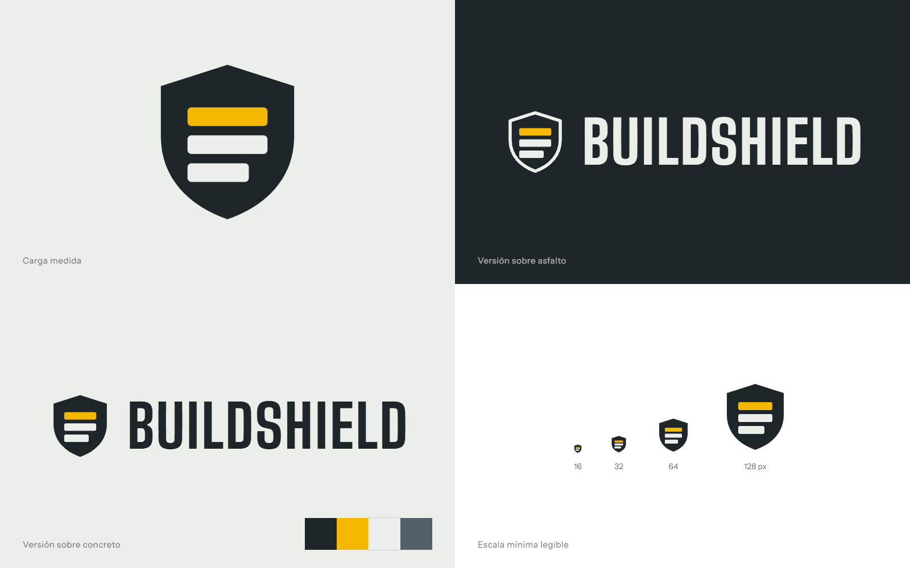

# Guía de estilo de BuildShield: «Señal de Obra»

Tema propio creado con la skill `theme-factory` (sección *Create your own theme*),
con reglas de accesibilidad de `ui-ux-pro-max`, dirección visual de
`frontend-design`, logotipo de `canvas-design` y auditoría final con
`web-design-guidelines`.

## Idea

BuildShield se usa en dos lugares: el escritorio del administrador y el celular
del encargado de obra, a pleno sol, con guantes y con prisa. El tema toma su
vocabulario de la señalética de obra: asfalto, concreto y un solo amarillo de alta
visibilidad. El amarillo es escaso a propósito: marca la identidad y el lugar donde
estás, nunca el texto.

El elemento memorable es el **medidor de merma** de la recepción: una barra que
compara lo recibido contra lo despachado y muestra la tolerancia como una línea.
Todo lo demás se mantiene sobrio para que ese medidor y el **recorrido del
despacho** (Preparado, En tránsito, Recibido) sean lo primero que se lee.

## Logotipo

- Escudo de asfalto con tres cargas apiladas. La superior en amarillo señal. La
  inferior es más corta: la merma que el producto detecta. Filosofía completa en
  [brand/filosofia-logo.md](brand/filosofia-logo.md).
- Archivos: `public/brand/mark.svg` (sobre fondos claros), `mark-reverse.svg`
  (sobre asfalto), `lockup.png`, `mark-512.png`, `mark-192.png`, `public/favicon.svg`.
- Espacio libre mínimo alrededor: la altura de una carga (7/64 del escudo).
- Tamaño mínimo: 16 px la marca sola, 120 px de ancho el logotipo completo.
- No cambiar colores, no girar, no agregar sombras ni contornos.

## Color

| Token | Hex | Uso |
|---|---|---|
| `--bs-asfalto` | `#1F2629` | Texto principal, barra lateral, botón primario |
| `--bs-concreto` | `#ECEEEA` | Fondo de la aplicación |
| `--bs-losa` | `#FFFFFF` | Superficies: paneles, tablas, campos |
| `--bs-senal` | `#F5B800` | Marca, indicador de sección activa, foco sobre asfalto. Nunca como color de texto sobre claro |
| `--bs-acero` | `#52606A` | Texto secundario (5,7:1 sobre concreto) |
| `--bs-junta` | `#CDD2CC` | Bordes y divisiones |
| `--bs-conforme` / `-bg` | `#1E6B45` / `#DDEFE3` | Dentro de tolerancia, completado |
| `--bs-merma` / `-bg` | `#B42318` / `#FBE4E1` | Fuera de tolerancia, error, acción destructiva |
| `--bs-transito` / `-bg` | `#1C5D99` / `#DFEAF5` | En tránsito, enlaces, información |
| `--bs-pendiente` / `-bg` | `#7A5300` / `#FFF1C7` | Preparado, registrado, por evaluar |

Reglas:
- Todo texto cumple 4,5:1 contra su fondo; los bordes de controles, 3:1.
- El estado nunca se comunica solo con color: cada insignia lleva texto y un
  punto con forma distinta por estado.
- Los componentes usan tokens, nunca hex sueltos.

## Tipografía

| Rol | Familia | Uso |
|---|---|---|
| Rótulo | **Big Shoulders Display** 700 y 800 | Títulos de página, códigos de manifiesto, cifras grandes del medidor |
| Texto | **Instrument Sans** 400, 500 y 600 | Todo lo demás: formularios, tablas, botones |

- Escala: 13, 14, 16 (base), 18, 22, 28, 36 px. Altura de línea 1,5 para texto,
  1,05 para rótulos.
- Cifras con `font-variant-numeric: tabular-nums` en tablas y medidores.
- Frases en tipo oración. Sin mayúsculas sostenidas en etiquetas; el rótulo
  condensado ya da carácter.

## Espacio, forma y profundidad

- Escala de espacio: 4, 8, 12, 16, 24, 32, 48 px.
- Radios por jerarquía: controles 6 px, paneles 10 px, insignias 999 px. No todo
  lleva el mismo radio.
- Paneles planos con borde de junta. Sin sombras de decoración; solo la barra fija
  de confirmar lleva sombra porque flota sobre el contenido.

## Componentes

- **Botón primario**: asfalto con texto blanco, alto mínimo 48 px (RNF21). Uno
  por pantalla.
- **Botón secundario**: losa con borde asfalto. **Destructivo**: texto merma.
- **Campos**: etiqueta visible siempre arriba, ayuda debajo, error junto al campo
  con `aria-describedby`. Nunca solo placeholder.
- **Insignias de estado**: punto más texto, colores de la tabla de estados.
- **Recorrido del despacho**: tres pasos en secuencia real (Preparado, En
  tránsito, Recibido). Es la única lista numerada del sistema porque es la única
  secuencia real.
- **Medidor de merma**: barra de lo recibido sobre lo despachado, línea de
  tolerancia y cifra grande en rótulo.
- **Tablas**: en menos de 720 px se convierten en fichas con etiqueta y valor.
- **Estados vacíos**: dicen qué falta y ofrecen la acción para resolverlo.

## Navegación

- Escritorio (900 px o más): barra lateral de asfalto con logotipo, secciones con
  ícono y la sección activa marcada con una franja amarilla.
- Celular: barra superior de asfalto con la marca y un botón de menú que abre el
  panel de secciones.
- Cada rol ve solo sus secciones.

## Movimiento y accesibilidad

- Transiciones de 150 a 200 ms solo en respuesta a acciones (abrir menú, guardar,
  confirmar). Nada se anima solo al cargar.
- `prefers-reduced-motion` desactiva todas las transiciones.
- Foco visible en todos los controles: anillo asfalto de 2 px con separación
  blanca sobre claro, anillo amarillo sobre asfalto.
- Objetivos táctiles de 48 px mínimo, 8 px de separación.
- Enlace «Saltar al contenido» al inicio de cada página.

## Redacción

- Verbos concretos: «Confirmar recepción», «Registrar pesaje», «Despachar».
- El botón y su mensaje usan la misma palabra: «Despachar» produce «Despacho en
  tránsito».
- Los errores dicen qué pasó y cómo seguir; no piden disculpas.
